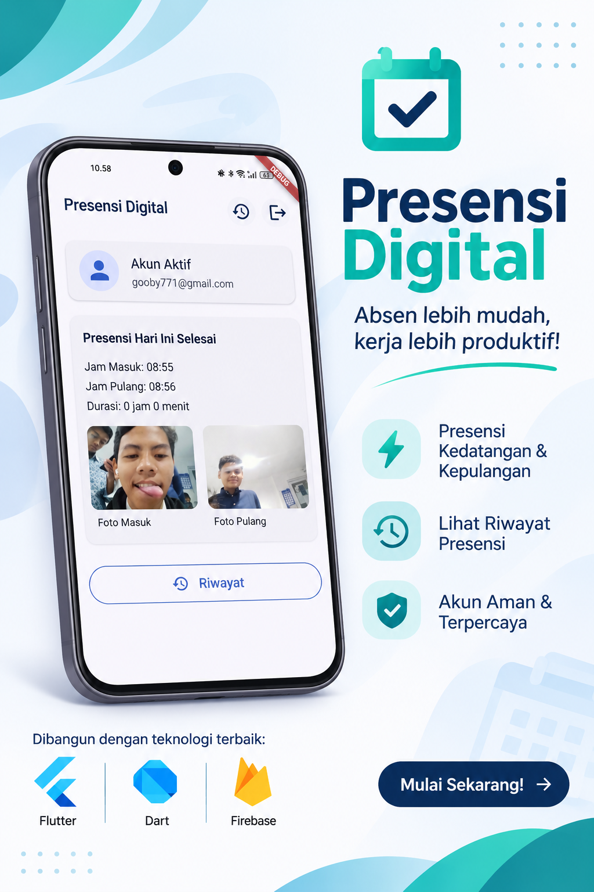

# MyAttend --- Presensi Digital


Aplikasi presensi karyawan berbasis Flutter untuk mencatat kedatangan
dan kepulangan, melihat ringkasan presensi harian, serta meninjau
riwayat presensi beserta dokumentasi foto.

> **Tech stack:** Flutter · Dart · Firebase

## Fitur

-   Login dan registrasi menggunakan akun email.
-   Presensi kedatangan (jam masuk).
-   Presensi kepulangan (jam pulang).
-   Ringkasan presensi harian dan durasi.
-   Dokumentasi foto masuk dan foto pulang.
-   Riwayat presensi.

> Catatan: Fitur dan tampilan yang tersedia mengikuti implementasi
> project saat ini. Fitur seperti GPS, validasi radius kantor, payroll,
> dan manajemen cuti tidak termasuk dalam cakupan aplikasi ini.

## Tech Stack

  ------------------------------------------------------------------------------------------------
  Teknologi                                                    Kegunaan
  ------------------------------------------------------------ -----------------------------------
  [Flutter](https://flutter.dev/)                              Framework aplikasi multiplatform

  [Dart](https://dart.dev/)                                    Bahasa pemrograman

  [Firebase](https://firebase.google.com/)                     Backend dan layanan aplikasi

  [Firebase                                                    Autentikasi pengguna (jika
  Authentication](https://firebase.google.com/products/auth)   diaktifkan pada Firebase project)
  ------------------------------------------------------------------------------------------------

## Persiapan

Pastikan perangkat development sudah memiliki:

-   Git
-   Flutter SDK dan Dart SDK (Dart sudah termasuk dalam Flutter)
-   Android Studio
-   Android SDK dan Android Emulator, atau HP Android dengan USB
    Debugging aktif
-   Node.js versi 20, 22, atau 24 untuk Firebase CLI (disarankan Node.js
    22 LTS)
-   Akun Google dan Firebase project

Periksa instalasi Flutter:

``` bash
flutter doctor -v
```

Ikuti petunjuk `flutter doctor` untuk menyelesaikan komponen Android
yang belum terpasang atau lisensi Android SDK yang belum diterima.

## Clone Repository

Ganti URL berikut dengan URL repository project yang sebenarnya:

``` bash
git clone https://github.com/USERNAME/REPOSITORY.git
cd REPOSITORY
```

## Setup di Windows

### 1. Install dan cek tools

Install Git, Flutter SDK, Android Studio, dan Node.js 22 LTS. Pastikan
folder `flutter\bin` sudah ditambahkan ke Windows PATH.

Buka PowerShell baru, lalu jalankan:

``` powershell
flutter --version
dart --version
node --version
npm --version
git --version
flutter doctor -v
```

### 2. Install Firebase CLI

``` powershell
npm install -g firebase-tools
firebase --version
firebase login
```

Perintah `firebase login` akan membuka browser untuk login ke akun
Google yang memiliki akses ke Firebase project.

### 3. Install FlutterFire CLI

``` powershell
dart pub global activate flutterfire_cli
```

Tambahkan folder berikut ke User PATH Windows jika perintah
`flutterfire` belum dikenali:

``` text
%LOCALAPPDATA%\Pub\Cache\bin
```

Tutup dan buka kembali PowerShell, lalu cek:

``` powershell
flutterfire --version
```

### 4. Konfigurasi Firebase

Dari root folder project:

``` powershell
flutterfire configure --project=YOUR_FIREBASE_PROJECT_ID
```

Ganti `YOUR_FIREBASE_PROJECT_ID` dengan Project ID Firebase milikmu.
Pilih platform Android (dan platform lain hanya jika memang digunakan
project).

Pastikan layanan Firebase yang diperlukan aplikasi sudah disiapkan di
Firebase Console, misalnya Authentication dengan metode Email/Password
apabila aplikasi menggunakan login email dan password.

### 5. Install dependency dan jalankan aplikasi

``` powershell
flutter pub get
flutter devices
flutter run
```

Untuk menjalankan ke perangkat tertentu:

``` powershell
flutter run -d DEVICE_ID
```

## Setup di Linux (Arch Linux)

### 1. Install tools sistem

``` bash
sudo pacman -S --needed git nodejs npm
```

Install Flutter SDK, Android Studio, Android SDK, dan Android
platform-tools sesuai panduan resmi masing-masing. Pastikan Flutter dan
Android SDK sudah masuk PATH.

Jika Flutter SDK sudah terpasang, cek:

``` fish
flutter --version
dart --version
node --version
npm --version
git --version
flutter doctor -v
```

Terima lisensi Android SDK jika diminta:

``` fish
flutter doctor --android-licenses
```

### 2. Install Firebase CLI

``` fish
npm install -g firebase-tools
firebase --version
firebase login
```

Gunakan Node.js versi 20, 22, atau 24. Node.js 22 LTS direkomendasikan
untuk menghindari peringatan kompatibilitas dependency Firebase CLI.

Jika npm global menampilkan `EACCES`, jangan langsung menjalankan
`sudo npm install -g`. Atur npm global prefix atau gunakan pengelola
versi Node.js yang kompatibel dengan Fish Shell.

### 3. Install FlutterFire CLI

``` fish
dart pub global activate flutterfire_cli
```

Tambahkan executable Dart global ke PATH Fish:

``` fish
fish_add_path -U $HOME/.pub-cache/bin
```

Buka terminal baru atau jalankan ulang Fish, lalu cek:

``` fish
flutterfire --version
```

### 4. Konfigurasi Firebase

Dari root folder project:

``` fish
flutterfire configure --project=YOUR_FIREBASE_PROJECT_ID
```

Ganti `YOUR_FIREBASE_PROJECT_ID` dengan Project ID Firebase milikmu.
Pilih Android sebagai platform jika aplikasi hanya ditargetkan untuk
Android.

### 5. Install dependency dan jalankan aplikasi

``` fish
flutter pub get
flutter devices
flutter run
```

Untuk menjalankan ke perangkat tertentu:

``` fish
flutter run -d DEVICE_ID
```

## Konfigurasi Firebase untuk teman yang melakukan clone

Firebase configuration terikat pada Firebase project milik pemilik
aplikasi. Setelah clone, kamu mungkin perlu menghubungkan aplikasi ke
Firebase project milikmu sendiri.

1.  Buat atau pilih project di [Firebase
    Console](https://console.firebase.google.com/).

2.  Daftarkan aplikasi Android menggunakan Android application ID yang
    ada di `android/app/build.gradle.kts` pada bagian `applicationId`.

3.  Aktifkan metode Authentication yang digunakan aplikasi (misalnya
    Email/Password).

4.  Login melalui Firebase CLI:

    ``` bash
    firebase login
    ```

5.  Jalankan FlutterFire Configure:

    ``` bash
    flutterfire configure --project=YOUR_FIREBASE_PROJECT_ID
    ```

6.  Ambil konfigurasi Firebase untuk project tersebut dan ikuti
    instruksi FlutterFire CLI.

7.  Jalankan:

    ``` bash
    flutter pub get
    flutter run
    ```

**Penting:** Jangan pernah memasukkan Firebase Admin SDK service
account, private key, token rahasia, atau kredensial server ke
repository publik. Atur Firebase Security Rules dan Authentication
sesuai kebutuhan aplikasi. File konfigurasi aplikasi klien bukan
pengganti Security Rules.

## Catatan untuk teman-teman yang suka nge-clone

Kalau kamu sudah baca sampai sini, selamat, literasimu masih ada
bre. :v

Terima kasih sudah mampir dan mencoba project ini. Jangan lupa sesuaikan
konfigurasi Firebase dengan project milikmu sendiri sebelum menjalankan
aplikasinya.

------------------------------------------------------------------------

Dibuat sebagai project pembelajaran dan pengembangan aplikasi presensi
digital.
# MyAttend-app
